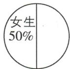
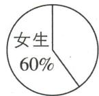

## 课时 1 扇形统计图 刷基础

电子错题本鸭

## 基础

## 知识点 1 扇形统计图

![[初中/课堂同步/教辅/必刷题/2026版《初中必刷题》数学 BS  7上/06_第六章_数据的收集与整理/课时_1_扇形统计图/questions/Q00098585.md]]
## 知识点 2 扇形统计图的应用

![[初中/课堂同步/教辅/必刷题/2026版《初中必刷题》数学 BS  7上/06_第六章_数据的收集与整理/课时_1_扇形统计图/questions/Q00098586.md]]
![[初中/课堂同步/教辅/必刷题/2026版《初中必刷题》数学 BS  7上/06_第六章_数据的收集与整理/课时_1_扇形统计图/questions/Q00098587.md]]
![[初中/课堂同步/教辅/必刷题/2026版《初中必刷题》数学 BS  7上/06_第六章_数据的收集与整理/课时_1_扇形统计图/questions/Q00098588.md]]
## 建议用时-20分钟

七（1）班男、女生
人数统计图

七（2）班男、女生人数统计图

A.七(2)班女生人数一定比七(1)班多  
B.两个班女生人数可能同样多  
C.七(2)班女生人数可能比七(1)班多  
D.七(2)班女生人数一定比男生多

![[初中/课堂同步/教辅/必刷题/2026版《初中必刷题》数学 BS  7上/06_第六章_数据的收集与整理/课时_1_扇形统计图/questions/Q00098589.md]]
![[初中/课堂同步/教辅/必刷题/2026版《初中必刷题》数学 BS  7上/06_第六章_数据的收集与整理/课时_1_扇形统计图/questions/Q00098590.md]]
## 提升
