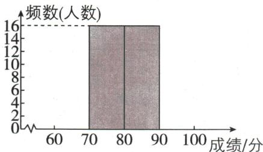
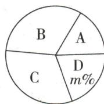

<!-- question-source:start -->
70 71 93 90 81 90 74 78 81 75

【整理描述数据】通过整理数据,得到以下尚不完整的频数分布表、频数直方图和扇形统计图:

<table><tr><td>组别</td><td>成绩分组</td><td>频数</td></tr><tr><td>A</td><td>60≤x&lt;70</td><td>a</td></tr><tr><td>B</td><td>70≤x&lt;80</td><td>16</td></tr><tr><td>C</td><td>80≤x&lt;90</td><td>16</td></tr><tr><td>D</td><td>90≤x≤100</td><td>b</td></tr></table>

↑频数(人数)

(1)频数分布表中 a= \_\_\_\_, b= \_\_\_\_, 并补全频数直方图.

(2)扇形统计图中 m=\_\_\_\_, D 所对应的扇形的圆心角度数是\_\_\_\_.

【应用数据】

(3)若成绩不低于90分为优秀,请你估计参加这次知识测试的七年级学生中,成绩为优秀的人数.

第1期 第2期 第3期 第4期 第5期 期次
<!-- question-source:end -->
