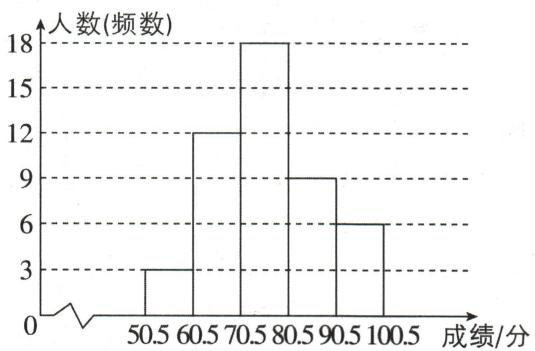

<!-- question-source:start -->
2 某班对学生的一次数学测试成绩(得分取整数)进行整理后分成五组,并绘制出如图所示的频数直方图,则下列说法中错误的是()

A.有6人的成绩为100分
B.这次共有48人参加测试
C.测试成绩高于70分且不高于80分的人数最多
D.若成绩在80分以上为优秀，则成绩优秀的有15人
<!-- question-source:end -->

![[Q00103218A1]]
