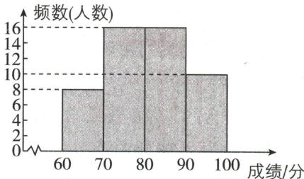

> [!success]- 必刷题
>
> > [!success] **【答案】** 8, 10
>
> > [!note]- **【解析】**
> > 【解】(1)频数分布表中 a=8, b=10, 故答案为 8, 10. 补全频数直方图如下:
> >
> > 
> >
> > (2) 因为 $m\% = \frac{10}{50} \times 100\% = 20\%$ , 所以 m = 20,
> > D 所对应的扇形的圆心角度数是 $360^{\circ} \times 20\% = 72^{\circ}$ . 故答案为 $20, 72^{\circ}$ .
> > (3) $600\times20\%=120.$
> >
> > 答:估计参加这次知识测试的七年级学生中,成绩为优秀的人数为 120.
> >
> > ## 课时3 统计图的选择
> >
> > 
