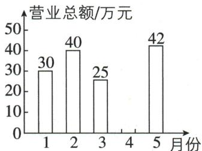
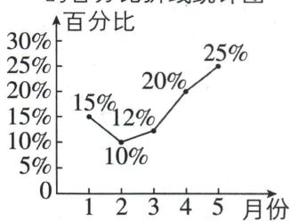

<!-- question-source:start -->
1[中]图(1)表示的是某书店今年1\~5月各月营业总额的情况,图(2)表示的是该书店今年1\~5月党史类书籍的各月营业额占书店当月营业总额的百分比情况.

今年1\~5月各月营业总额条形统计图

今年1\~5月党史类书籍的各月营业额占书店当月营业总额的百分比折线统计图

  
图(1)

  
图(2)

若该书店今年1\~5月的营业总额是182万元，某同学结合统计图分析得到如下结论： $①$ 该书店4月份的营业总额为45万元； $②$ 党史类书籍5月份的营业额为10.5万元； $③$ 党史类书籍4月份的营业额最高； $④$ 党史类书籍5月份的营业额最高.上述结论中正确的是 （）A. $④$ B. $②③$ C. $①②③$ D. $①②④$
<!-- question-source:end -->
