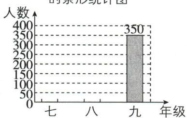
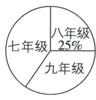
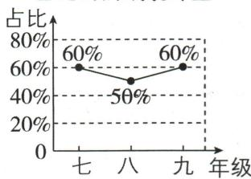

<!-- question-source:start -->
2[2025 河南郑州质检, 中]某校七、八、九年级共有 1 000 名学生. 学校统计了各年级学生的人数, 绘制了如图(1)、图(2)所示的两幅不完整的统计图.

(1) 将图(1)的条形统计图补充完整.

(2)图(2)中,表示七年级学生人数的扇形的圆心角度数为\_\_\_\_°.

(3)学校数学兴趣小组调查了各年级男生的人数,绘制了如图(3)所示的各年级男生人数占比的折线统计图(年级男生人数占比= $\frac{该年级男生人数}{该年级总人数}\times100\%$ ).请结合相关信息,绘制一幅适当的统计图,表示各年级男生及女生的人数,并在图中标明相应的数据.

某校各年级学生人数的条形统计图

某校各年级学生人数的扇形统计图

  
图(1)

  
图(2)

某校各年级男生人数占比的折线统计图

  
图(3)
<!-- question-source:end -->
