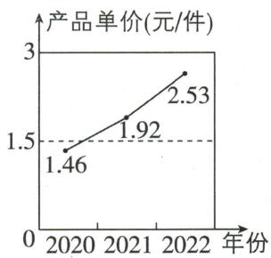
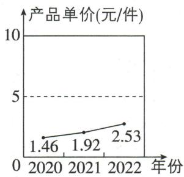

<!-- question-source:start -->
2 某公司近三年来的产品单价如下表所示:

<table><tr><td>年份</td><td>2020</td><td>2021</td><td>2022</td></tr><tr><td>产品单价(元/件)</td><td>1.46</td><td>1.92</td><td>2.53</td></tr></table>

该公司若根据上述信息制作统计图,并据此向物价部门申请涨价,你认为两幅图中,图\_\_\_\_是该公司绘制的(填“(1)”或“(2)”).

图(1)

图(2)
<!-- question-source:end -->

![[Q00103228A1]]
