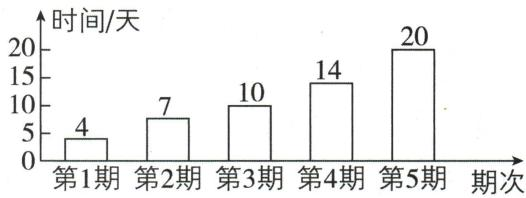
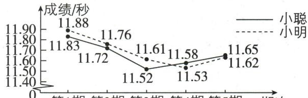

<!-- question-source:start -->
4[2025 浙江宁波质检]小聪、小明参加了100米跑的5期集训,每期集训结束时进行测试.根据他们集训时间、测试成绩绘制成如下两个统计图.

1\~5期每期的集训时间统计图

1\~5期每期小明、小聪的测试成绩统计图

根据图中信息,解答下列问题:

(1)这5期的集训共有多少天?

(2)哪一期小聪的成绩比他上一期的成绩进步最多？进步了多少秒？

(3) 根据统计数据, 结合体育运动的实际, 从集训时间和测试成绩这两方面, 简要说说你的想法.
<!-- question-source:end -->

![[Q00103230A1]]
