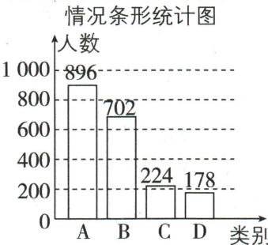
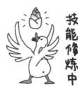

<!-- question-source:start -->
3[2024 辽宁沈阳沈河区期末, 中]为推广“荷式开门法”, 某公益团队在全市范围开展了专项宣传活动. 在活动前和活动后分别随机抽取了部分市民, 就执行“荷式开门法”情况进行问卷调查, 将收集的数据制成统计图表.

活动前执行“荷式开门法”活动后执行“荷式开门法”

情况统计表

<table><tr><td>类别</td><td>人数</td></tr><tr><td>A(每次)</td><td>68</td></tr><tr><td>B(经常)</td><td>a</td></tr><tr><td>C(偶尔)</td><td>510</td></tr><tr><td>D(从不)</td><td>177</td></tr><tr><td>合计</td><td>1000</td></tr></table>

(1)请计算 $a$ 的值.

(2)①为了更直观地反映 A、B、C、D 各类别所占的百分比,最适合的统计图是\_\_\_\_。(填“扇形统计图”或“条形统计图”或“折线统计图”)

②宣传活动前,抽取的市民中哪一类别的人数占比最大?求其所在扇形对应圆心角的度数.

(3)若该市有20万人,请估计该市活动前从不执行“荷式开门法”的人数.

(4) 小明认为, 宣传活动后从不执行“荷式开门法”的人数为 178, 比活动前增加了 1 人, 因此公益团队开展的宣传活动没有效果. 小明分析数据的方法是否合理? 请说明理由.

是个新“烤”鸭

电子错题本鸭
<!-- question-source:end -->

![[Q00103233A1]]
