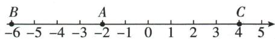

> [!success]- 必刷题
>
> > [!success] **【答案】** 6
>
> > [!note]- **【解析】**
> > 【解】(1) $A, B, C$ 三点的位置如图所示.
> >
> > 
> >
> > (2) $CA = 4 - (-2) = 4 + 2 = 6(\mathrm{cm})$ .故答案为6.  
> > (3) $CA - AB$ 的值不会随着 $t$ 的变化而变化.理由如下：根据题意得 $CA = (4 + 5t) - (-2 + t) =$ $6 + 4t,AB = (-2 + t) - (-6 - 3t) = 4 + 4t$ ，所以 $CA-$
> >
> > $AB=(6+4t)-(4+4t)=2$ , 所以 CA-AB 的值不会随着 t 的变化而变化.
