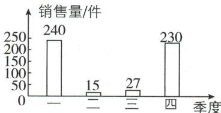
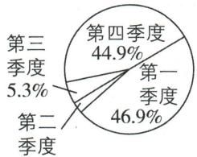
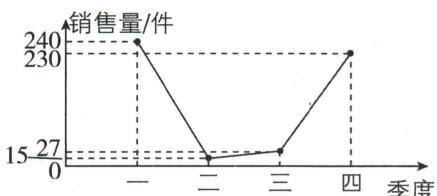

> [!success]- 必刷题
>
> > [!success] **【答案】** 详见解析
>
> > [!note]- **【解析】**
> > 【解】(1)由题中表格信息可得羽绒服专卖店2024年第一季度销售量为 $120+90+30=$ 240(件)，第二季度销售量为 $10+2+3=15$ (件)，第三季度销售量为 $3+4+20=27$ (件)，第四季度销售量为 $80+110+40=230$ (件).
> > 用条形统计图表示,如图(1)所示:
> >
> > 
> > 图(1)
> >
> > (2)全年总销量为 $240+15+27+230=512$ (件).
> > 第一季度所占百分比: $\frac{240}{512}\times100\%\approx46.9\%$ , 第二季度所占百分比: $\frac{15}{512}\times100\%\approx2.9\%$ , 第三季度所占百分比: $\frac{27}{512}\times100\%\approx5.3\%$ , 第四季度所占百分比: $\frac{230}{512}\times100\%\approx44.9\%$ .
> > 故各季度所在扇形的圆心角度数分别为
> >
> > 168. $84^{\circ}$ , 10. $44^{\circ}$ , 19. $08^{\circ}$ , 161. $64^{\circ}$ .
> > 用扇形统计图表示,如图(2)所示:
> >
> > 
> > 图(2)
> >
> > (3)用折线统计图表示,如图(3):
> >
> > 
> > 图(3)
> >
> > (4) 结论: 第一、四季度是销售旺季, 而第二、三季度是销售淡季. 建议: 在销售旺季多购进羽绒服进行售卖, 在淡季考虑经营其他适合第二、三季度销售的商品. (答案不唯一, 合理即可)
> >
> > ## 刷有所得
> >
> > 三种统计图的特点不同决定了它们的用途各不相同,要根据实际需要和题目要求来选择.
