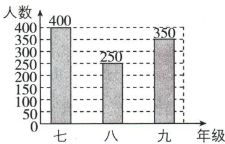
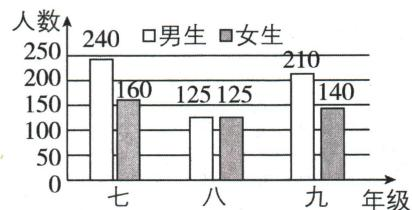

> [!success]- 必刷题
>
> > [!success] **【答案】** 144
>
> > [!note]- **【解析】**
> > 【解】(1)八年级人数: $1\ 000 \times 25\% = 250$ ,七年级人数: $1\ 000 - 250 - 350 = 400$ ,补全条形统计图如图(1)所示:
> >
> > # 某校各年级学生人数的条形统计图
> >
> > 
> > 图(1)
> >
> > (2) $360^{\circ}\times\frac{400}{1000}=144^{\circ}$ . 故答案为 144.
> >
> > (4) 求出宣传活动前、后从不执行“荷式开门法”的人数所占百分比, 即可判断.
> >
> > (3)七年级:男生有 $400 \times 60\% = 240$ (人), 女生有 $400 \times (1 - 60\%) = 160$ (人);
> > 八年级:男生有 $250 \times 50\% = 125$ (人), 女生有 $250 \times (1 - 50\%) = 125$ (人);
> > 九年级:男生有 $350 \times 60\% = 210$ (人), 女生有 $350 \times (1 - 60\%) = 140$ (人).
> > 用条形统计图表示如图(2)所示：
> >
> > 某校各年级男、女生人数的条形统计图
> >
> > 
> > 图(2)
