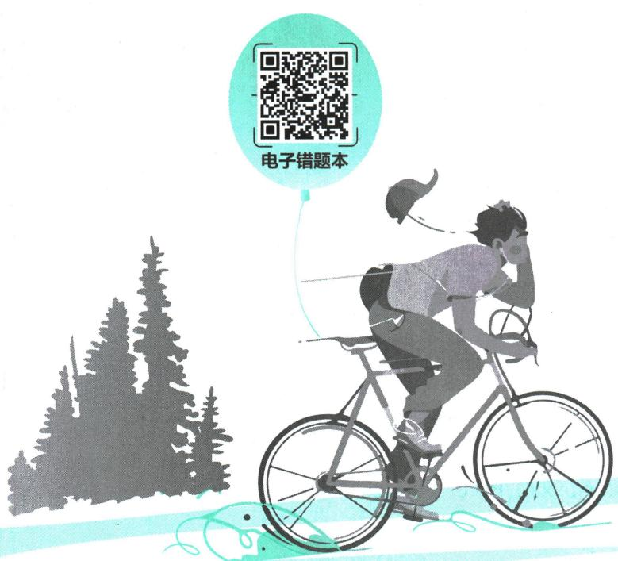
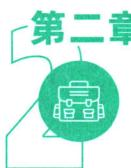
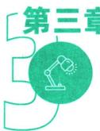
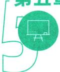
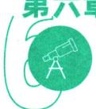

<!-- source-part:1 pages:1-50 -->

# 初中 2026 BISHUATI 初中 初中

主 编：杨文彬

编者：许生友 王岳阳 孟超 王道魁 张来
郭丽 李卫国 孙继平 李鑫 金萍萍
柏铁娟 杨莜 莘亚奇 李振 秦伟
刘婧君 朱光峰 李培华

审订：陈露

开明出版社

数学
七年级上册BS

## 目录

## 第一章 丰富的图形世界

(正文)(答案)

1 生活中的立体图形 …… (1) (D1)
课时 1 生活中的立体图形 …… 刷基础 (1) (D1)
课时 2 几何体的构成 …… 刷基础 (2) (D1)

2 从立体图形到平面图形 …… (3) (D2)
课时 1 正方体的展开与折叠 …… 刷基础 提升 (3) (D2)
课时 2 柱体、锥体的展开与折叠 …… 刷基础 (5) (D3)
课时 3 截一个几何体 …… 刷基础 提升 (6) (D3)
课时 4 从三个方向看物体的形状 …… 刷基础 (8) (D4)

全章综合训练 …… 刷中考 章测 (9) (D5)

重难题型微课

骰子点数之和的最值问题 P4T5 几何体的顶点个数问题 P7T3

## 第二章 有理数及其运算

1 认识有理数 …… (11) (D6)
课时 1 有理数 …… 刷基础 提升 (11) (D6)
课时 2 相反数与绝对值 …… 刷基础 提升 (13) (D7)
课时 3 数轴 …… 刷基础 提升 (15) (D8)
2 有理数的加减运算 …… (17) (D10)
课时 1 有理数的加法 …… 刷基础 提升 (17) (D10)
课时 2 有理数的加法运算律 …… 刷基础 提升 (19) (D11)
课时 3 有理数的减法 …… 刷基础 提升 (21) (D12)
课时 4 有理数的加减混合运算 …… 刷基础 提升 (23) (D13)
课时 5 有理数加减混合运算的实际应用 …… 刷基础 (25) (D14)
3 有理数的乘除运算 …… (26) (D14)
课时 1 有理数的乘法 …… 刷基础 提升 (26) (D14)
课时 2 有理数的乘法运算律 …… 刷基础 提升 (28) (D16)
课时 3 有理数的除法 …… 刷基础 提升 (30) (D17)
4 有理数的乘方 …… (32) (D18)
课时 1 有理数的乘方 …… 刷基础 (32) (D18)
课时 2 科学记数法 …… 刷基础 (33) (D19)
5 有理数的混合运算 …… (34) (D19)
课时 1 有理数的混合运算 …… 刷基础 提升 (34) (D19)
课时 2 用计算器进行运算 …… 刷基础 (36) (D20)
重难专题 1 巧用运算规律简化有理数的计算 … 刷难关 (37) (D21)
大招专题 1 有关数轴的探索 …… 刷难关 (38) (D22)
全章综合训练 …… 刷中考 章测 (39) (D23)

## 新考法 新素材

研究对比全国近十年中考真题卷,发现各省市的中考会不断借鉴或探究新考法,同时会挖掘时事热点等新素材,创造新情境灵活考查知识点。中考是我们平时学习的风向标,因此我们需要关注新考法、新素材。

## 新考法

\- 正方体的展开
- 从不同方向观察物体的应用
- 结合数轴考查有理数的减法
- 角的比较方法
- 角的和差运算
- P3/T2
- P10/T3
- P22/T1
- P64/T2
- P64/T5
- P83/T2
- 通过框图直观分析实际问题
- P85/T1

## 新素材

\- 以电影《哪吒之魔童闹海》为背景考查科学记数法 AI原创
- P33/T3
- 以 DeepSeek(深度求索)科技公司为背景考查列代数式 AI原创
- P42/T7

## 新考向

## 推荐理由

教育部发布的《关于加强初中学业水平考试命题工作的意见》中指出:弘扬中华优秀传统文化,提高探究性、开放性、综合性试题比例,积极探索跨学科命题,提高试题情境设计水平。结合《义务教育数学课程标准(2022年版)》新变化,通过分析全国百余套中考试题,发现以传统文化为背景的试题,以及探究性、开放性、综合性、跨学科试题在中考中出现得越来越频繁,故精选部分试题,让学生感受考向变化。

<table><tr><td>微专题1</td><td>绝对值最值问题</td><td>P16</td></tr><tr><td>微专题2</td><td>整式中不含(无关)问题</td><td>P50</td></tr><tr><td>微专题3</td><td>解含绝对值的一元一次方程</td><td>P75</td></tr></table>

## 目录

## 重难题型微课

<table><tr><td>正负数的应用</td><td>P12T3</td><td>数轴上的整点问题</td><td>P16T1</td></tr><tr><td>添“正、负号”求最值问题</td><td>P24T6</td><td>拆项法</td><td>P37T8</td></tr><tr><td>倒序相加法</td><td>P37T11</td><td>有理数加法法则的应用</td><td>P40T7</td></tr></table>

## 第三章 整式及其加减

1 代数式 …… (42) (D25)
课时1 代数式 …… 刷基础 (42) (D25)
课时2 代数式的应用 …… 刷基础 提升 (43) (D25)
课时3 整式 …… 刷基础 提升 (45) (D26)
2 整式的加减 …… (47) (D28)
课时1 同类项及合并同类项 …… 刷基础 (47) (D28)
课时2 去括号 …… 刷基础 (48) (D28)
课时3 整式的加减 …… 刷基础 提升 (49) (D29)
重难专题2 整式的化简求值 …… 刷难关 (51) (D30)
3 探索与表达规律 …… (52) (D30)
课时1 探索与表达规律 …… 刷基础 (52) (D30)
课时2 借助运算探索规律 …… 刷提升 (53) (D31)
☆问题解决策略：归纳 …… 刷提升 (54) (D31)
全章综合训练 …… 刷中考 章测 (55) (D32)

## 重难题型微课

整式运算中的整体思想 P50T6 日历表中的规律问题 P52T2
整式加减运算中的无关问题 P57T13

## 第四章 基本平面图形

1 线段、射线、直线 …… (58) (D33)
课时 1 线段、射线、直线 …… 刷基础 (58) (D33)
课时 2 比较线段的长短 …… 刷基础 提升 (59) (D34)
大招专题 2 与线段上的中点有关的计算 …… 刷难关 (61) (D36)
重难专题 3 线段的动态问题 …… 刷难关 (62) (D37)
2 角 …… (63) (D38)
课时 1 角 …… 刷基础 (63) (D38)
课时 2 角的比较 …… 刷基础 提升 (64) (D38)
大招专题 3 双角平分线模型 …… 刷难关 (66) (D40)
重难专题 4 动角问题 …… 刷难关 (67) (D41)
3 多边形和圆的初步认识 …… 刷基础 (68) (D42)
全章综合训练 …… 刷中考 章测 (69) (D42)

## 重难题型微课

“折中点”问题 P60T4 直线上的动点问题 P60T5
与线段中点有关的计算 P61T2 三等分线的分类讨论 P65T3
旋转角的探究问题 P71T16

## 专题索引

## 微专题

## 重难专题

## 重难专题1 巧用运算规律简化有理数的计算 P37

类型1 归类组合法
类型2 逆用乘法对加法的分配律
类型3 凑整法
类型4 分组搭配法
类型5 拆项法
类型6 倒数法
类型7 倒序相加法

## 重难专题2 整式的化简求值 P51

类型1 化繁为简再求值
类型2 整体代入求值
类型3 整体加减求值
类型4 整式的化简求值与数轴、绝对值的综合

## 重难专题3 线段的动态问题 P62

## 重难专题4 动角问题 P67

## 重难专题5 特殊一元一次方程的解题技巧 P78

类型1 分母化整再去分母
类型2 利用倒数关系去括号
类型3 整体思想的应用
类型4 先拆分，再合并
类型5 分组通分

## 目录

## 第五章 一元一次方程

1 认识方程 …… 刷基础 (72) (D44)
2 一元一次方程的解法 …… (73) (D45)
课时1 等式的基本性质 …… 刷基础 (73) (D45)
课时2 求解一元一次方程——移项 …… 刷基础 (74) (D46)
课时3 求解一元一次方程——去括号 …… 刷基础 (75) (D46)
课时4 求解一元一次方程——去分母
…… 刷基础 提升 (76) (D47)
重难专题5 特殊一元一次方程的解题技巧 …… 刷难关 (78) (D49)
大招专题4 含参数的一元一次方程 …… 刷难关 (79) (D50)
3 一元一次方程的应用 …… (80) (D50)
课时1 形积变化 …… 刷基础 提升 (80) (D50)
课时2 “盈不足”问题 …… 刷基础 (82) (D52)
课时3 行程问题 …… 刷基础 提升 (83) (D52)
☆问题解决策略：直观分析 …… 刷基础 (85) (D53)
重难专题6 一元一次方程应用的其他八种
类型 …… 刷难关 (86) (D54)
大招专题5 方程的应用——动点问题 …… 刷难关 (89) (D55)
全章综合训练 …… 刷中考 章测 (90) (D56)
重难题型微课
方程的恒解问题 P77T6 分组通分解方程 P78T8
正方形轨道中的追及问题 P84T2 工程问题 P86T4

## 第六章 数据的收集与整理

1 丰富的数据世界 …… 刷基础 (93) (D58)
2 数据的收集 …… 刷基础 (94) (D58)
3 数据的表示 …… (95) (D59)
课时 1 扇形统计图 …… 刷基础 提升 (95) (D59)
课时 2 频数直方图 …… 刷基础 (97) (D60)
课时 3 统计图的选择 …… 刷基础 提升 (98) (D60)
全章综合训练 …… 刷中考 章测 (100) (D62)
重难题型微课
折线统计图的选择 P98T2

## 综合与实践

关注人口老龄化 …… 刷实践（103）(D63)
制作一个尽可能大的无盖长方体形收纳盒 …… 刷实践（104）(D63)

## 中考新考向备训

\- 新考向1 传统文化
- 新考向2 跨学科综合
- 新考向3 开放性试题
- 新考向4 22版课标新增知识点

## 专题索引

## 重难专题6 一元一次方程应用的其他八种类型 P86

类型1 和差倍分问题
类型2 工程问题
类型3 配套问题
类型4 方案问题
类型5 分段计费问题
类型6 积分问题
类型7 年龄问题
类型8 数字问题(含日历)

## 大招专题

大招专题1 有关数轴的探索 P38 母题学大招1 数轴中的折叠问题 母题学大招2 数轴上循环规律问题 母题学大招3 数轴上数的变化规律问题

## 大招专题2 与线段上的中点有关的计算 P61

母题学大招4 双中点模型母题学大招5 三中点模型

## 大招专题 3 双角平分线模型 P66

母题学大招6 两个角无公共部分
母题学大招7 两个角有公共部分
母题学大招8 三个角围成周角

## 大招专题4 含参数的一元一次方程

母题学大招9 解的关系问题
母题学大招10 错解问题
母题学大招11 整数解问题
母题学大招12 解的个数问题

## 大招专题5 方程的应用——动点问题 P89

母题学大招13 距离问题
母题学大招14 相遇问题
母题学大招15 追及问题

## 光 light up your life 李研慧

夜深
寒风阵阵 海浪翻滚
隐藏着的灵魂
怎肯默默无闻
曾与礁石相撞
不屈遍体鳞伤
也曾掀起巨浪

回首与月相望
月光洒在海上
怅惘黑夜漫长
月落参横
破晓梦想迎来曙光
我不应是月亮
我本就会发光

![[初中/课堂同步/教辅/必刷题/2026版《初中必刷题》数学 BS  7上/01_第一章_丰富的图形世界/课时_1_生活中的立体图形/课时_1_生活中的立体图形.md]]
![[初中/课堂同步/教辅/必刷题/2026版《初中必刷题》数学 BS  7上/01_第一章_丰富的图形世界/课时_2_几何体的构成/课时_2_几何体的构成.md]]
![[初中/课堂同步/教辅/必刷题/2026版《初中必刷题》数学 BS  7上/01_第一章_丰富的图形世界/课时_1_正方体的展开与折叠/刷基础.md]]
![[初中/课堂同步/教辅/必刷题/2026版《初中必刷题》数学 BS  7上/01_第一章_丰富的图形世界/课时_1_正方体的展开与折叠/刷提升.md]]
![[初中/课堂同步/教辅/必刷题/2026版《初中必刷题》数学 BS  7上/01_第一章_丰富的图形世界/课时_2_柱体_锥体的展开与折叠/课时_2_柱体_锥体的展开与折叠.md]]
![[初中/课堂同步/教辅/必刷题/2026版《初中必刷题》数学 BS  7上/01_第一章_丰富的图形世界/课时_3_截一个几何体/刷基础.md]]
![[初中/课堂同步/教辅/必刷题/2026版《初中必刷题》数学 BS  7上/01_第一章_丰富的图形世界/课时_3_截一个几何体/刷提升.md]]
![[初中/课堂同步/教辅/必刷题/2026版《初中必刷题》数学 BS  7上/01_第一章_丰富的图形世界/课时_4_从三个方向看物体的形状/课时_4_从三个方向看物体的形状.md]]
![[初中/课堂同步/教辅/必刷题/2026版《初中必刷题》数学 BS  7上/01_第一章_丰富的图形世界/全章综合训练/刷中考.md]]
![[初中/课堂同步/教辅/必刷题/2026版《初中必刷题》数学 BS  7上/01_第一章_丰富的图形世界/全章综合训练/刷章测.md]]
![[初中/课堂同步/教辅/必刷题/2026版《初中必刷题》数学 BS  7上/02_第二章_有理数及其运算/课时_1_有理数/刷基础.md]]
![[初中/课堂同步/教辅/必刷题/2026版《初中必刷题》数学 BS  7上/02_第二章_有理数及其运算/课时_1_有理数/刷提升.md]]
![[初中/课堂同步/教辅/必刷题/2026版《初中必刷题》数学 BS  7上/02_第二章_有理数及其运算/课时_2_相反数与绝对值/刷基础.md]]
![[初中/课堂同步/教辅/必刷题/2026版《初中必刷题》数学 BS  7上/02_第二章_有理数及其运算/课时_2_相反数与绝对值/刷提升.md]]
![[初中/课堂同步/教辅/必刷题/2026版《初中必刷题》数学 BS  7上/02_第二章_有理数及其运算/课时_3_数轴/刷基础.md]]
![[初中/课堂同步/教辅/必刷题/2026版《初中必刷题》数学 BS  7上/02_第二章_有理数及其运算/课时_3_数轴/刷提升.md]]
![[初中/课堂同步/教辅/必刷题/2026版《初中必刷题》数学 BS  7上/02_第二章_有理数及其运算/课时_1_有理数的加法/刷基础.md]]
![[初中/课堂同步/教辅/必刷题/2026版《初中必刷题》数学 BS  7上/02_第二章_有理数及其运算/课时_1_有理数的加法/刷提升.md]]
![[初中/课堂同步/教辅/必刷题/2026版《初中必刷题》数学 BS  7上/02_第二章_有理数及其运算/课时_2_有理数的加法运算律/刷基础.md]]
![[初中/课堂同步/教辅/必刷题/2026版《初中必刷题》数学 BS  7上/02_第二章_有理数及其运算/课时_2_有理数的加法运算律/刷提升.md]]
![[初中/课堂同步/教辅/必刷题/2026版《初中必刷题》数学 BS  7上/02_第二章_有理数及其运算/课时_3_有理数的减法/刷基础.md]]
![[初中/课堂同步/教辅/必刷题/2026版《初中必刷题》数学 BS  7上/02_第二章_有理数及其运算/课时_3_有理数的减法/刷提升.md]]
![[初中/课堂同步/教辅/必刷题/2026版《初中必刷题》数学 BS  7上/02_第二章_有理数及其运算/课时_4_有理数的加减混合运算/刷基础.md]]
![[初中/课堂同步/教辅/必刷题/2026版《初中必刷题》数学 BS  7上/02_第二章_有理数及其运算/课时_4_有理数的加减混合运算/刷提升.md]]
![[初中/课堂同步/教辅/必刷题/2026版《初中必刷题》数学 BS  7上/02_第二章_有理数及其运算/课时_5_有理数加减混合运算的实际应用/课时_5_有理数加减混合运算的实际应用.md]]
![[初中/课堂同步/教辅/必刷题/2026版《初中必刷题》数学 BS  7上/02_第二章_有理数及其运算/课时_1_有理数的乘法/刷基础.md]]
![[初中/课堂同步/教辅/必刷题/2026版《初中必刷题》数学 BS  7上/02_第二章_有理数及其运算/课时_1_有理数的乘法/刷提升.md]]
![[初中/课堂同步/教辅/必刷题/2026版《初中必刷题》数学 BS  7上/02_第二章_有理数及其运算/课时_2_有理数的乘法运算律/刷基础.md]]
![[初中/课堂同步/教辅/必刷题/2026版《初中必刷题》数学 BS  7上/02_第二章_有理数及其运算/课时_2_有理数的乘法运算律/刷提升.md]]
![[初中/课堂同步/教辅/必刷题/2026版《初中必刷题》数学 BS  7上/02_第二章_有理数及其运算/课时_3_有理数的除法/刷基础.md]]
![[初中/课堂同步/教辅/必刷题/2026版《初中必刷题》数学 BS  7上/02_第二章_有理数及其运算/课时_3_有理数的除法/刷提升.md]]
![[初中/课堂同步/教辅/必刷题/2026版《初中必刷题》数学 BS  7上/02_第二章_有理数及其运算/课时_1_有理数的乘方/课时_1_有理数的乘方.md]]
![[初中/课堂同步/教辅/必刷题/2026版《初中必刷题》数学 BS  7上/02_第二章_有理数及其运算/课时_2_科学记数法/课时_2_科学记数法.md]]
![[初中/课堂同步/教辅/必刷题/2026版《初中必刷题》数学 BS  7上/02_第二章_有理数及其运算/课时_1_有理数的混合运算/刷基础.md]]
![[初中/课堂同步/教辅/必刷题/2026版《初中必刷题》数学 BS  7上/02_第二章_有理数及其运算/课时_1_有理数的混合运算/刷提升.md]]
![[初中/课堂同步/教辅/必刷题/2026版《初中必刷题》数学 BS  7上/02_第二章_有理数及其运算/课时_2_用计算器进行运算/课时_2_用计算器进行运算.md]]
![[初中/课堂同步/教辅/必刷题/2026版《初中必刷题》数学 BS  7上/02_第二章_有理数及其运算/重难专题_1_巧用运算规律简化有理数的计算/重难专题_1_巧用运算规律简化有理数的计算.md]]
![[初中/课堂同步/教辅/必刷题/2026版《初中必刷题》数学 BS  7上/02_第二章_有理数及其运算/大招专题_1_有关数轴的探索/大招专题_1_有关数轴的探索.md]]
![[初中/课堂同步/教辅/必刷题/2026版《初中必刷题》数学 BS  7上/02_第二章_有理数及其运算/全章综合训练/刷中考.md]]
![[初中/课堂同步/教辅/必刷题/2026版《初中必刷题》数学 BS  7上/02_第二章_有理数及其运算/全章综合训练/刷章测.md]]
![[初中/课堂同步/教辅/必刷题/2026版《初中必刷题》数学 BS  7上/03_第三章_整式及其加减/课时1_代数式/课时1_代数式.md]]
![[初中/课堂同步/教辅/必刷题/2026版《初中必刷题》数学 BS  7上/03_第三章_整式及其加减/课时2_代数式的应用/刷基础.md]]
![[初中/课堂同步/教辅/必刷题/2026版《初中必刷题》数学 BS  7上/03_第三章_整式及其加减/课时2_代数式的应用/刷提升.md]]
![[初中/课堂同步/教辅/必刷题/2026版《初中必刷题》数学 BS  7上/03_第三章_整式及其加减/课时3_整式/刷基础.md]]
![[初中/课堂同步/教辅/必刷题/2026版《初中必刷题》数学 BS  7上/03_第三章_整式及其加减/课时3_整式/刷提升.md]]
![[初中/课堂同步/教辅/必刷题/2026版《初中必刷题》数学 BS  7上/03_第三章_整式及其加减/课时1_同类项及合并同类项/课时1_同类项及合并同类项.md]]
![[初中/课堂同步/教辅/必刷题/2026版《初中必刷题》数学 BS  7上/03_第三章_整式及其加减/课时2_去括号/课时2_去括号.md]]
![[初中/课堂同步/教辅/必刷题/2026版《初中必刷题》数学 BS  7上/03_第三章_整式及其加减/课时3_整式的加减/刷基础.md]]
![[初中/课堂同步/教辅/必刷题/2026版《初中必刷题》数学 BS  7上/03_第三章_整式及其加减/课时3_整式的加减/刷提升.md]]
![[初中/课堂同步/教辅/必刷题/2026版《初中必刷题》数学 BS  7上/03_第三章_整式及其加减/重难专题2_整式的化简求值/重难专题2_整式的化简求值.md]]
![[初中/课堂同步/教辅/必刷题/2026版《初中必刷题》数学 BS  7上/03_第三章_整式及其加减/课时1_探索与表达规律/课时1_探索与表达规律.md]]
![[初中/课堂同步/教辅/必刷题/2026版《初中必刷题》数学 BS  7上/03_第三章_整式及其加减/课时2_借助运算探索规律/课时2_借助运算探索规律.md]]
![[初中/课堂同步/教辅/必刷题/2026版《初中必刷题》数学 BS  7上/03_第三章_整式及其加减/_问题解决策略_归纳/_问题解决策略_归纳.md]]
![[初中/课堂同步/教辅/必刷题/2026版《初中必刷题》数学 BS  7上/03_第三章_整式及其加减/全章综合训练/刷中考.md]]
![[初中/课堂同步/教辅/必刷题/2026版《初中必刷题》数学 BS  7上/03_第三章_整式及其加减/全章综合训练/刷章测.md]]
![[初中/课堂同步/教辅/必刷题/2026版《初中必刷题》数学 BS  7上/04_第四章_基本平面图形/课时_1_线段_射线_直线/课时_1_线段_射线_直线.md]]
![[初中/课堂同步/教辅/必刷题/2026版《初中必刷题》数学 BS  7上/04_第四章_基本平面图形/课时_2_比较线段的长短/刷基础.md]]
![[初中/课堂同步/教辅/必刷题/2026版《初中必刷题》数学 BS  7上/04_第四章_基本平面图形/课时_2_比较线段的长短/刷提升.md]]
![[初中/课堂同步/教辅/必刷题/2026版《初中必刷题》数学 BS  7上/04_第四章_基本平面图形/大招专题_2_与线段上的中点有关的计算/大招专题_2_与线段上的中点有关的计算.md]]
![[初中/课堂同步/教辅/必刷题/2026版《初中必刷题》数学 BS  7上/04_第四章_基本平面图形/重难专题_3_线段的动态问题/重难专题_3_线段的动态问题.md]]
![[初中/课堂同步/教辅/必刷题/2026版《初中必刷题》数学 BS  7上/04_第四章_基本平面图形/课时_1_角/课时_1_角.md]]
![[初中/课堂同步/教辅/必刷题/2026版《初中必刷题》数学 BS  7上/04_第四章_基本平面图形/课时_2_角的比较/刷基础.md]]
![[初中/课堂同步/教辅/必刷题/2026版《初中必刷题》数学 BS  7上/04_第四章_基本平面图形/课时_2_角的比较/刷提升.md]]
![[初中/课堂同步/教辅/必刷题/2026版《初中必刷题》数学 BS  7上/04_第四章_基本平面图形/大招专题_3_双角平分线模型/大招专题_3_双角平分线模型.md]]
![[初中/课堂同步/教辅/必刷题/2026版《初中必刷题》数学 BS  7上/04_第四章_基本平面图形/重难专题_4_动角问题/重难专题_4_动角问题.md]]
![[初中/课堂同步/教辅/必刷题/2026版《初中必刷题》数学 BS  7上/04_第四章_基本平面图形/3_多边形和圆的初步认识/3_多边形和圆的初步认识.md]]
![[初中/课堂同步/教辅/必刷题/2026版《初中必刷题》数学 BS  7上/04_第四章_基本平面图形/全章综合训练/刷中考.md]]
![[初中/课堂同步/教辅/必刷题/2026版《初中必刷题》数学 BS  7上/04_第四章_基本平面图形/全章综合训练/刷章测.md]]
![[初中/课堂同步/教辅/必刷题/2026版《初中必刷题》数学 BS  7上/05_第五章_一元一次方程/1_认识方程/1_认识方程.md]]
![[初中/课堂同步/教辅/必刷题/2026版《初中必刷题》数学 BS  7上/05_第五章_一元一次方程/课时1_等式的基本性质/课时1_等式的基本性质.md]]
![[初中/课堂同步/教辅/必刷题/2026版《初中必刷题》数学 BS  7上/05_第五章_一元一次方程/课时2_求解一元一次方程__移项/课时2_求解一元一次方程__移项.md]]
![[初中/课堂同步/教辅/必刷题/2026版《初中必刷题》数学 BS  7上/05_第五章_一元一次方程/课时3_求解一元一次方程__去括号/课时3_求解一元一次方程__去括号.md]]
![[初中/课堂同步/教辅/必刷题/2026版《初中必刷题》数学 BS  7上/05_第五章_一元一次方程/课时4_求解一元一次方程__去分母/刷基础.md]]
![[初中/课堂同步/教辅/必刷题/2026版《初中必刷题》数学 BS  7上/05_第五章_一元一次方程/课时4_求解一元一次方程__去分母/刷提升.md]]
![[初中/课堂同步/教辅/必刷题/2026版《初中必刷题》数学 BS  7上/05_第五章_一元一次方程/重难专题5_特殊一元一次方程的解题技巧/重难专题5_特殊一元一次方程的解题技巧.md]]
![[初中/课堂同步/教辅/必刷题/2026版《初中必刷题》数学 BS  7上/05_第五章_一元一次方程/大招专题4_含参数的一元一次方程/大招专题4_含参数的一元一次方程.md]]
![[初中/课堂同步/教辅/必刷题/2026版《初中必刷题》数学 BS  7上/05_第五章_一元一次方程/课时1_形积变化/刷基础.md]]
![[初中/课堂同步/教辅/必刷题/2026版《初中必刷题》数学 BS  7上/05_第五章_一元一次方程/课时1_形积变化/刷提升.md]]
![[初中/课堂同步/教辅/必刷题/2026版《初中必刷题》数学 BS  7上/05_第五章_一元一次方程/课时2__盈不足_问题/课时2__盈不足_问题.md]]
![[初中/课堂同步/教辅/必刷题/2026版《初中必刷题》数学 BS  7上/05_第五章_一元一次方程/课时3_行程问题/刷基础.md]]
![[初中/课堂同步/教辅/必刷题/2026版《初中必刷题》数学 BS  7上/05_第五章_一元一次方程/课时3_行程问题/刷提升.md]]
![[初中/课堂同步/教辅/必刷题/2026版《初中必刷题》数学 BS  7上/05_第五章_一元一次方程/_问题解决策略_直观分析/_问题解决策略_直观分析.md]]
![[初中/课堂同步/教辅/必刷题/2026版《初中必刷题》数学 BS  7上/05_第五章_一元一次方程/类型/类型.md]]
![[初中/课堂同步/教辅/必刷题/2026版《初中必刷题》数学 BS  7上/05_第五章_一元一次方程/大招专题5_方程的应用__动点问题/大招专题5_方程的应用__动点问题.md]]
![[初中/课堂同步/教辅/必刷题/2026版《初中必刷题》数学 BS  7上/05_第五章_一元一次方程/全章综合训练/刷中考.md]]
![[初中/课堂同步/教辅/必刷题/2026版《初中必刷题》数学 BS  7上/05_第五章_一元一次方程/全章综合训练/刷章测.md]]
![[初中/课堂同步/教辅/必刷题/2026版《初中必刷题》数学 BS  7上/06_第六章_数据的收集与整理/1_丰富的数据世界/1_丰富的数据世界.md]]
![[初中/课堂同步/教辅/必刷题/2026版《初中必刷题》数学 BS  7上/06_第六章_数据的收集与整理/2_数据的收集/2_数据的收集.md]]
![[初中/课堂同步/教辅/必刷题/2026版《初中必刷题》数学 BS  7上/06_第六章_数据的收集与整理/课时_1_扇形统计图/刷基础.md]]
![[初中/课堂同步/教辅/必刷题/2026版《初中必刷题》数学 BS  7上/06_第六章_数据的收集与整理/课时_1_扇形统计图/刷提升.md]]
![[初中/课堂同步/教辅/必刷题/2026版《初中必刷题》数学 BS  7上/06_第六章_数据的收集与整理/课时_2_频数直方图/课时_2_频数直方图.md]]
![[初中/课堂同步/教辅/必刷题/2026版《初中必刷题》数学 BS  7上/06_第六章_数据的收集与整理/课时_3_统计图的选择/刷基础.md]]
![[初中/课堂同步/教辅/必刷题/2026版《初中必刷题》数学 BS  7上/06_第六章_数据的收集与整理/课时_3_统计图的选择/刷提升.md]]
![[初中/课堂同步/教辅/必刷题/2026版《初中必刷题》数学 BS  7上/06_第六章_数据的收集与整理/全章综合训练/刷中考.md]]
![[初中/课堂同步/教辅/必刷题/2026版《初中必刷题》数学 BS  7上/06_第六章_数据的收集与整理/全章综合训练/刷章测.md]]
![[初中/课堂同步/教辅/必刷题/2026版《初中必刷题》数学 BS  7上/06_第六章_数据的收集与整理/关注人口老龄化/关注人口老龄化.md]]
![[初中/课堂同步/教辅/必刷题/2026版《初中必刷题》数学 BS  7上/06_第六章_数据的收集与整理/制作一个尽可能大的无盖长方体形收纳盒/制作一个尽可能大的无盖长方体形收纳盒.md]]
