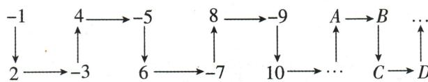

<!-- question-source:start -->
7 核心素养运算能力[中]如图,将一串正负数按下列规律排列,有以下说法:

(1) 在 $A$ 处的数是正数；

(2)负数不可能排在A,B的位置;

(3) 排在 $C, D$ 处的数都是负数；

(4) 按以上顺序排列的第 2022 个数是正数.
其中说法正确的有
( )
A. 4 个 B. 3 个 C. 2 个 D. 1 个
<!-- question-source:end -->

![[Q00096771A1]]
