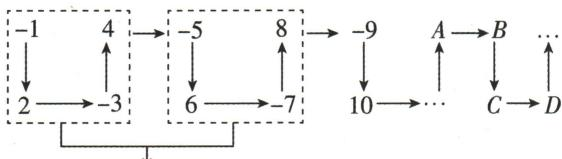

> [!success]- 必刷题
>
> > [!success] **【答案】** C
>
> > [!note]- **【解析】**
> > 
> >
> > 每四个数的位置相同，对应位置上数的符号相同
> >
> > A 是向上箭头的上方对应的数, 则与 4 的符号相同, 所以在 A 处的数是正数, 故 (1) 说法正确. 观察发现, 向下箭头的上方的数是负数, 下方的数是正数; 向上箭头的下方的数是负数, 上方的数是正数, 所以排在 B, D 处的数都是负数, 排在 A, C 处的数都是正数, 故 (2) (3) 说法错误. 因为 $2022 \div 4 = 505 \cdots 2$ , 所以第 2022 个数是正数, 故 (4) 说法正确. 综上所述, 正确的有 (1) (4), 共 2 个. 故选 C.
> >
> > ## 1.2 有理数及其大小比较
