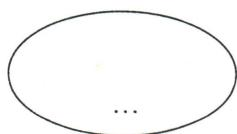
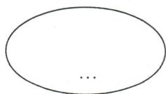
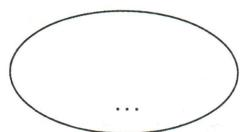
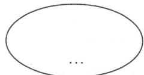

<!-- question-source:start -->
8[2025 河北邢台质检]把下列各数填入表示它所在的集合的圈里(如图):
-0.72,-2,-98,25, $\frac{8}{3}$ ,6.3%,10,-3.14.

  
负整数

正整数  
  
正分数

  
负分数

这四种数的集合合并在一起\_\_\_\_（填“是”或“不是”）全体有理数集合.
<!-- question-source:end -->

![[Q00096774A1]]
