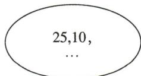
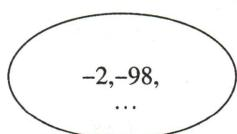
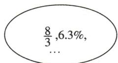
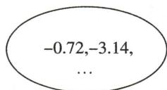

> [!success]- 必刷题
>
> > [!success] **【答案】** 不是
>
> > [!note]- **【解析】**
> > 【解】如图所示：
> >
> > 
> > 正整数
> >
> > 
> > 负整数
> >
> > 
> > 正分数
> >
> > 
> > 负分数
> >
> > 因为有理数分为正有理数、零和负有理数，正有理数包含正整数和正分数，负有理数包含负整数和负分数，所以这四种数的集合合并在一起不是全体有理数集合。故答案为不是。
> >
> > ## 1.2.2 数轴
