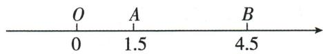

<!-- question-source:start -->
6[2025 河南驻马店校级期末]如图, 点 O, A, B 在数轴上, 分别表示数 0, 1.5, 4.5, 数轴上另有

建议用时 20 分钟 答案 D3

一点 C, 到点 A 的距离为 1, 到点 B 的距离小于 3, 则点 C 位于
( )
A. 点 O 的左边    B. 点 O 与点 A 之间
C. 点 B 的右边    D. 点 A 与点 B 之间

<!-- question-source:end -->

![[Q00095218A1]]
