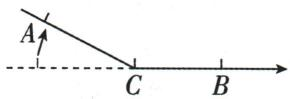
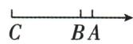

<!-- question-source:start -->
1[2025江西上饶期末,中]在一条可以折叠的数轴上,点A,B表示的数分别是-10,3,如图(1),以点C为折点,将此数轴向右对折得到图(2),若点A在点B的右边,且AB=1,则点C表示的数是()

图(1) 图(2)
A. -4 B. -3 C. -1 D. 0
<!-- question-source:end -->

![[Q00096775A1]]
