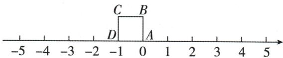

<!-- question-source:start -->
3[2025 河北邢台质检, 中]如图, 正方形 ABCD 在数轴上的位置如图所示, 点 D, A 对应的数分别为 -1 和 0, 若正方形 ABCD 在数轴上绕着顶点顺时针连续无滑动翻转, 翻转 1 次后, 点 B 在数轴上对应的数为 1. 在正方形 ABCD 连续翻转的过程中, 下列说法错误的是 ( )

A. 翻转 3 次后, 点 D 与在数轴上表示 3 的点重合
B. 翻转 4 次后, 与数轴重合的两个顶点表示的数分别为 3 和 4
C. 在翻转过程中, 顶点 B 可与数轴上表示 14 的点重合
D. 连续翻转 2024 次后, 数轴上数 2024 所对应的点是 A
<!-- question-source:end -->

![[Q00096777A1]]
