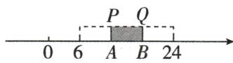

<!-- question-source:start -->
5 核心素养推理能力 [2024 河南周口质检, 中] 李老师善于通过知识迁移, 对问题进行拓展探究, 培养同学们用数学的思维思考现实世界的能力. 下面是李老师在“数轴的实际应用”主题下设计的问题, 请你解答.

(1)知识回顾:如图(1),数轴上有一个表示数a的点M,已知点M在数轴上向右移动3个单位长度后表示的数是5,那么a的值是\_\_\_\_.

  
图(1)

  
图(2)

(2) 探究迁移: 如图(2), 有一根木尺 PQ 放置在数轴上, 它的两端 P, Q 分别落在 A, B 两点处. 将木尺在数轴上水平移动, 当点 P 移动到点 B 时, 点 Q 所对应的数为 24; 当点 Q 移动到点 A 时, 点 P 所对应的数为 6 (单位: cm). 利用所学知识求出点 A、点 B 所表示的数及木尺 PQ 的长.

(3)拓展应用:一天,小明去问爷爷的年龄.爷爷说:“我若是你现在这么大,你还要40年才出生呢;你若是我现在这么大,我已经是116岁了!”请你利用(2)的方法,求出小明和爷爷的年龄.
<!-- question-source:end -->

![[Q00096779A1]]
