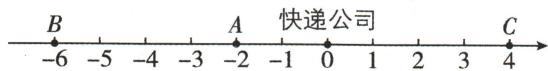

> [!success]- 必刷题
>
> > [!success] **【答案】** 3 或 -7
>
> > [!note]- **【解析】**
> > 【解】(1)如图所示:
> >
> > 
> >
> > (2) 因为快递员从 B 小区向南骑行 1 000 m 到达 C 小区, 所以 C 小区离 B 小区的距离是 1 000 m.
> >
> > (3) 易知 C 小区离快递公司的距离为 400 m, $200 + 400 + 1\ 000 + 400 = 2\ 000 \, (\text{m})$ , 所以快递员一共骑行了 $2\ 000 \, m = 2 \, km$ .
> >
> > 易错警示
> > 由于题目没有具体说明点 B 的位置, 故解决本题需分点 B 在点 A 的左侧和点 B 在点 A 的右侧两种情况讨论.
> >
> > ## 刷易错
> >
> > 
> >
> > 研究线段盖住数轴上的整点个数的问题，首先要考虑线段的端点是否与数轴上的整点重合，其次要结合数轴，利用数形结合思想解决问题.
> >
> > 9.3 或 -7 【解析】当点 B 在点 A 左侧时, 点 B 表示的数是 -7; 当点 B 在点 A 右侧时, 点 B 表示的数是 3. 故答案为 3 或 -7.
