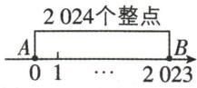
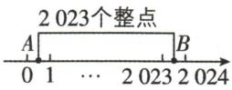

> [!success]- 必刷题
>
> > [!success] **【答案】** B
>
> > [!note]- **【解析】**
> > 在题图(1)中, 因为点 A, B 表示的数分别是 -10, 3, 所以 AB = 13. 在题图(2)中, AB = 1, 所以 $BC = \frac{1}{2} \times (13 - 1) = 6$ , 所以点 C 表示的数是 -3. 故选 B.
> >
> > 刷有所得◀2. A 【解析】
> >
> > <table><tr><td>线段AB的端点与数轴上的整点重合</td><td></td></tr><tr><td>线段AB的端点不与数轴上的整点重合</td><td></td></tr></table>
