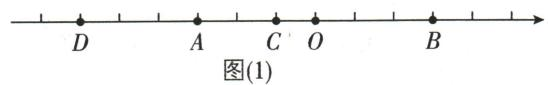

> [!success]- 必刷题
>
> > [!success] **【答案】** 2
>
> > [!note]- **【解析】**
> > 【解】(1)因为点 M 在数轴上向右移动 3 个单位长度后表示的数是 5, 所以 a=5-3=2. 故答案为 2.
> >
> > (2)由题意可知,B 点到数 24 对应的点的距离、PQ 的长、A 点到数 6 对应的点的距离相等, 所以 $PQ = (24 - 6) \div 3 = 6$ , 所以 A 点表示的数为 $6 + 6 = 12$ , B 点表示的数为 24 - 6 = 18.
> >
> > 
> >
> > (3)如图:
> >
> > 遇到多重括号化简时,一定要从内往外或从外往内按顺序去括号.
> >
> > <table><tr><td>-40</td><td>小明</td><td>爷爷</td><td>116</td></tr></table>
> >
> > 爷爷和小明的年龄差为 $(116+40)\div3=52$ （岁），所以爷爷的年龄为 $116-52=64$ （岁），小明的年龄为64-52=12（岁），所以小明的年龄为12岁，爷爷的年龄为64岁.
