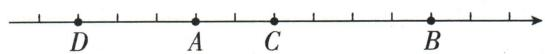

<!-- question-source:start -->
5[2024 新疆喀什期中]如图, 图中数轴的单位长度为 1. 请回答下列问题:
(1) 如果点 A, B 表示的数互为相反数, 那么点 C 表示的数是多少?
(2) 如果点 D, B 表示的数互为相反数, 那么点 C, D 表示的数是多少?

<!-- question-source:end -->

![[Q00096784A1]]
