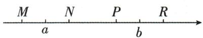

<!-- question-source:start -->
2 新考法[2025 福建福州期中, 中]如图, M, N, P, R 分别是数轴上四个整数所对应的点, 其中有一点是原点, 并且 MN = NP = PR = 1. 数 a 对应的点在 M 与 N 之间, 数 b 对应的点在 P 与 R 之间. 若 $\left|a\right| + \left|b\right| = 2$ , 则原点是 ( )

A. $M$ 或 $N$ B. $M$ 或 $R$ C. $N$ 或 $P$ D. $P$ 或 $R$
<!-- question-source:end -->

![[Q00096802A1]]
