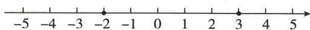
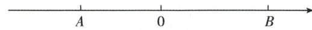
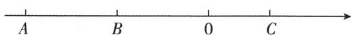

> [!success]- 必刷题
>
> > [!success] **【答案】** 7, $-3 \leqslant x \leqslant 4$
>
> > [!note]- **【解析】**
> > 【解】(1) $|x+2|+|x-3|=5$ 表示数轴上有理数x对应的点到-2和3对应的两点的距离之和为5,如图(1).
> >
> > 
> > 图(1)
> >
> > ## 技巧点拨
> >
> > 奇数个取中间值,偶数个取中间段.
> >
> > 因为表示-2和表示3的两点之间的距离是5,所以在-2和3之间(含-2和3)的整数均符合题意,所以所有符合条件的整数x为-2,-1,0,1,2,3.
> >
> > (2) ①因为 $|x + 3| + |x - 4| = |x - (-3)| + |x - 4|$ , 所以 $|x + 3| + |x - 4|$ 表示数轴上有理数 $x$ 对应的点到-3和4对应的两点的距离之和. 假设点 $P$ 在数轴上表示的数是 $x$ , 点 $A$ 表示的数是-3, 点 $B$ 表示的数是4, 则点 $P$ 可能在点 $A$ 的左边或点 $A$ 和点 $B$ 之间 (含点 $A$ 和点 $B$ ) 或点 $B$ 的右边. 如图(2)所示, 当点 $P$ 在点 $A$ 的左边或点 $B$ 的右边时, 点 $P$ 到 $A, B$ 两点的距离之和均大于 $A, B$ 两点间的距离; 当点 $P$ 在点 $A$ 和点 $B$ 之间 (含点 $A$ 和点 $B$ ) 时, 点 $P$ 到 $A, B$ 两点的距离之和等于 $A, B$ 两点间的距离, 所以 $x$ 在-3和4之间 (含-3和4), 即 $-3 \leqslant x \leqslant 4$ , $|x + 3| + |x - 4|$ 的最小值为7. 故答案为7, $-3 \leqslant x \leqslant 4$ .
> >
> > 
> > 图(2)
> > - **②**：因为 $|x+7|+|x+4|+|x-2|+|x-5|=|x-(-7)|+|x-(-4)|+|x-2|+|x-5|$ ，所以x在-4和2之间（含-4和2），即 $-4\leqslant x\leqslant2$ ，代数式 $|x+7|+|x+4|+|x-2|+|x-5|$ 的最小值为18.故答案为 $18,-4\leqslant x\leqslant2$ .
> >
> > (3)①因为 $|x+6|+|x+3|+|x-2|=|x-(-6)|+|x-(-3)|+|x-2|$ ，所以 $|x+6|+|x+3|+|x-2|$ 表示数轴上有理数x对应的点到-6,-3和2对应的三点的距离之和。假设点P在数轴上表示的数是x，点A表示的数是-6，点B表示的数是-3，点C表示的数是2，如图(3)所示，当点P在点B处时，P到A,B,C三点的距离之和等于A,C两点间的距离；当点P在除点B外的任意位置时，P到A,B,C三点的距离之和均大于A,C两点间的距离，所以当x=-3时， $|x+6|+|x+3|+|x-2|$ 有最小值，为8。故答案为8,-3。
> >
> > 
> > 图(3)
> > - **②**：因为 $(1+617)\div2=309$ ，所以当x=309时， $|x-1|+|x-2|+|x-3|+\cdots+|x-617|$ 取得最小值。故答案为309。
