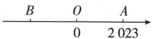

<!-- question-source:start -->
5[2023 四川自贡中考]如图, 数轴上点 A 表示的数是 2023, OA = OB, 则点 B 表示的数是( )
A. 2023
B. -2023
C. $\frac{1}{2023}$ D. - $\frac{1}{2023}$

<!-- question-source:end -->

![[Q00096823A1]]
