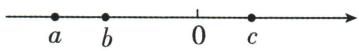

<!-- question-source:start -->
11[2023 山东潍坊中考改编]有理数 a, b, c 在数轴上对应的点如图所示, 下列判断正确的是 ( )

A. $-c < b$ B. $a > -c$ C. $|a - b| = b - a$ D. $|c - a| = a - c$
<!-- question-source:end -->

![[Q00096829A1]]
