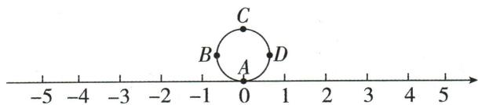

<!-- question-source:start -->
5[2024 辽宁葫芦岛调研]如图所示,圆的周长为 4 个单位长度,在圆周的 4 等分点处分别标上字母 A,B,C,D,先将圆周上的字母 A 对应的点与数轴上的原点重合,再将圆沿着数轴向右滚动,那么圆周上与数轴上表示 1949 的点重合的点是 ( )

A. $A$ B. $B$ C. $C$ D. $D$
<!-- question-source:end -->

![[Q00098660A1]]
