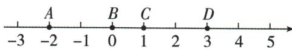
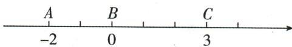

<!-- question-source:start -->
13[2025 山东临沂期中]操作与探究：

(1)如图(1)，写出数轴上点A,B,C,D表示的数.

(2)如图(2),点A,B,C为数轴上的三个点,当点B为原点时,点A表示的数是-2,点C表示的数是3;若以点C为原点,则点A表示的数是\_\_\_\_,点B表示的数是\_\_\_\_;若点B,C表示的两个数互为相反数,则点B表示的数是\_\_\_\_,点A表示的数是\_\_\_\_.

(3) 如果将数轴上一点 E 向右移动 2 个单位长度, 再向左移动 5 个单位长度后, 终点表示的数是 -1, 求原来点 E 表示的数.

图(1)

图(2)
<!-- question-source:end -->

![[Q00098668A1]]
