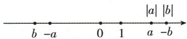

> [!success]- 必刷题
>
> > [!success] **【答案】** A
>
> > [!note]- **【解析】**
> > 在数轴上标出-a, |a|, -b 和 |b| 的对应点的位置如图所示, 根据数轴上左边的数小于右边的数, 可得 |b| > a, b < -a, a < -b, |a| < |b|. 故选 A.
> >
> > 易错警示
> >
> > 
> >
> > 已知数轴上两点之间的距离和其中一点表示的数,求另一点所表示的数时,一定要注意分类讨论,不要漏解.
