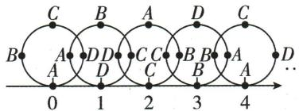

> [!success]- 必刷题
>
> > [!success] **【答案】** D
>
> > [!note]- **【解析】**
> > 识图解题 | 数轴上的规律问题
> >
> > 
> >
> > 由图可以看出,以 D,C,B,A 四个字母为一次循环. 因为 $1\ 949 \div 4 = 487 \cdots 1$ , 所以数轴上表示 1 949 的点与圆周上的字母 D 重合.
> >
> > 故选 **D**.
