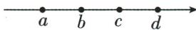

<!-- question-source:start -->
8[2024 山东德州期末]有理数 a, b, c, d 在数轴上的对应点的位置如图所示, 则在下列说法中, 正确的是 ( )

①若 $ad > 0$ ，则一定会有 $bc > 0$ ②若 $ad <   0$ ，则一定会有 $bc <   0$ ③若 $bc > 0$ ，则一定会有 $ad > 0$ ④若 $bc <   0$ ，则一定会有 $ad <   0$ A. $①③$ B. $①④$ C. $②③$ D. $②④$
<!-- question-source:end -->

![[Q00101602A1]]
