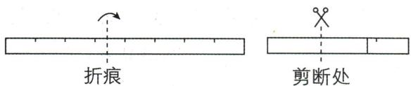

<!-- question-source:start -->
3[2024 浙江金华期中, 中]在数轴上剪下 8 个单位长度(从 1 到 9)的一条线段, 并把这条线段沿某点折叠, 然后在重叠部分某处剪一刀得到三条线段(如图). 若这三条线段的长度之比为 1:1:2, 则折痕与数轴的交点所表示的数可能是 \_\_\_\_.

<!-- question-source:end -->

![[Q00098811A1]]
