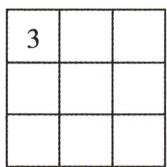
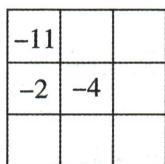

<!-- question-source:start -->
4[2025 河南漯河期中]正方形中每一横行、每一竖列及两条对角线上的几个数之和都相等, 称为“幻方”. 图(1)的幻方中每一横行、每一竖列以及两条对角线上的数的和都是 15.

<table><tr><td>4</td><td>9</td><td>2</td></tr><tr><td>3</td><td>5</td><td>7</td></tr><tr><td>8</td><td>1</td><td>6</td></tr></table>

图(1)

图(2)

图(3)

(1)图(1)中9个数之和是15的\_\_\_\_倍,15是9个格的“中心数”5的\_\_\_\_倍;

(2)请将-4,-3,-2,-1,0,1,2,4这8个数填入图(2)的幻方中；

(3)在图(3)的幻方中,填上合适的数.
<!-- question-source:end -->

![[Q00100444A1]]
