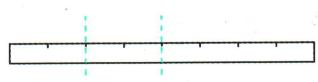
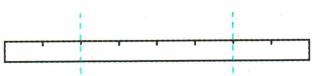
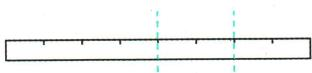

> [!success]- 必刷题
>
> > [!success] **【答案】** 18 或 -14
>
> > [!note]- **【解析】**
> > 因为表示 5 的点与表示 -1 的点重合, 所以折痕与数轴的交点表示的数为 2. 因为数轴折叠后, 数轴上的 A, B 两点也重合, 且 A, B 两点之间的距离为 32, 所以两个点到折痕与数轴交点的距离均是 16, 所以点 A 表示的数为 $2 + 16 = 18$ 或 2 - 16 = -14. 故答案为 18 或 -14.
> >
> > 3.4 或 5 或 6 【解析】因为总的线段长为 8, 剪后三条线段的长度之比为 1:1:2, 又因为 $8 \div (1 + 1 + 2) = 2$ , 所以这三条线段的长度分别为
> >
> > 2,2,4. 如图(1)，若剪下的第1条线段长为2，第2条线段长度也为2，则折痕与数轴的交点表示的数为4；如图(2)，若剪下的第1条线段长为2，第2条线段长度为4，则折痕与数轴的交点表示的数为5；如图(3)，若剪下的第1条线段长为4，第2条线段长度为2，则折痕与数轴的交点表示的数为6。综上，折痕与数轴的交点表示的数为4或5或6，故答案为4或5或6。
> >
> > 
> > 图(1)
> >
> > 
> > 图(2)
> >
> > 
> > 图(3)
> >
> > ## 大招解读 | 数轴上的循环规律问题
