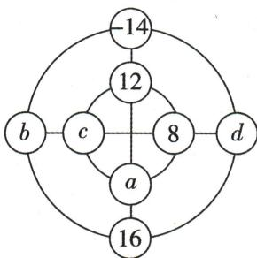
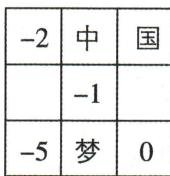

<!-- question-source:start -->
2[2025 江苏扬州期中]将“幻方”游戏稍作改进变成“幻圆”游戏, 规则如下: 将 -2, 4, -6, 8, -10, 12, -14, 16 分别填入图中的圆圈内, 使横、竖以及内外两个圆上的圆圈内 4 个数字之和都相等, 则 $a + b$ 的值为 ( )
A. -6 或 -12 B. -2 或 -8
C. 2 或 -2 D. 2 或 -16

(第2题图)

(第3题图)
<!-- question-source:end -->

![[Q00096960A1]]
