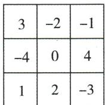
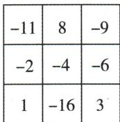

> [!success]- 必刷题
>
> > [!success] **【答案】** 3,3
>
> > [!note]- **【解析】**
> > 【解】(1)题图(1)中每一横行上的数的和都是15,所以9个数之和是15的3倍.15是9个格的“中心数”5的3倍.故答案为3,3.
> >
> > (2)如图(1).(答案不唯一)
> >
> > ## 关键点拨
> >
> > 利用有理数的加、减法法则，根据所给的条件推出 b, d 的可能取值是解题的关键.
> >
> > ## 关键点拨
> >
> > (2)根据每一横行、每一竖列以及两条对角线上的数的和都相等,且等于“中心数”的3倍求解.
> >
> > 
> > 图(1)
> >
> > 
> > 图(2)
> >
> > (3)如图(2).
