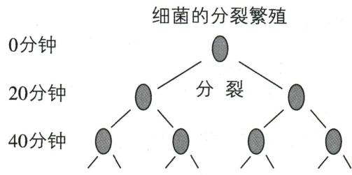

<!-- question-source:start -->
6 新考向跨学科综合 [2024 北京朝阳区期中] 多数细菌是靠二分裂进行繁殖的, 也就是 1 个细菌分裂成 2 个细菌, 分裂完的细菌长大以后又能进行分裂, 例如, 图中所示为某种细菌分裂的示意图, 这种细菌每 20 分钟就能分裂一次, 1

建议用时-20分钟

个这种细菌经过3个小时可以分裂成\_\_\_\_个细菌.

<!-- question-source:end -->

![[Q00096916A1]]
