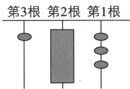

<!-- question-source:start -->
2 新考向传统文化 [2025 江苏宿迁期中, 中] 根据我国古代《易经》记载, 远古时期人们通过在绳子上打结来记录数量, 即“结绳计数”. 如图, 一人在从右到左依次排列的绳子上打结, 满七进一, 用来记录采集到的野果的个数. 已知他一共采集到的野果数不少于 75 个, 则他在第 2 根绳子上打结的可能情况有 ( )

A. 1 种 B. 2 种 C. 3 种 D. 4 种
<!-- question-source:end -->

![[Q00096927A1]]
