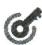

## 课时1 有理数的乘法

电子错题本鸭

## 知识点 1 有理数的乘法法则

![[初中/课堂同步/教辅/必刷题/2026版《初中必刷题》数学 RJ  7上/02_第二章_有理数的运算/课时1_有理数的乘法/questions/Q00098715.md]]
![[初中/课堂同步/教辅/必刷题/2026版《初中必刷题》数学 RJ  7上/02_第二章_有理数的运算/课时1_有理数的乘法/questions/Q00098716.md]]
![[初中/课堂同步/教辅/必刷题/2026版《初中必刷题》数学 RJ  7上/02_第二章_有理数的运算/课时1_有理数的乘法/questions/Q00098717.md]]
![[初中/课堂同步/教辅/必刷题/2026版《初中必刷题》数学 RJ  7上/02_第二章_有理数的运算/课时1_有理数的乘法/questions/Q00098718.md]]

## 知识点 2 倒数

![[初中/课堂同步/教辅/必刷题/2026版《初中必刷题》数学 RJ  7上/02_第二章_有理数的运算/课时1_有理数的乘法/questions/Q00098719.md]]
![[初中/课堂同步/教辅/必刷题/2026版《初中必刷题》数学 RJ  7上/02_第二章_有理数的运算/课时1_有理数的乘法/questions/Q00098720.md]]
![[初中/课堂同步/教辅/必刷题/2026版《初中必刷题》数学 RJ  7上/02_第二章_有理数的运算/课时1_有理数的乘法/questions/Q00098721.md]]
![[初中/课堂同步/教辅/必刷题/2026版《初中必刷题》数学 RJ  7上/02_第二章_有理数的运算/课时1_有理数的乘法/questions/Q00098722.md]]
![[初中/课堂同步/教辅/必刷题/2026版《初中必刷题》数学 RJ  7上/02_第二章_有理数的运算/课时1_有理数的乘法/questions/Q00098723.md]]
![[初中/课堂同步/教辅/必刷题/2026版《初中必刷题》数学 RJ  7上/02_第二章_有理数的运算/课时1_有理数的乘法/questions/Q00098724.md]]

## 知识点 1 多个有理数相乘

![[初中/课堂同步/教辅/必刷题/2026版《初中必刷题》数学 RJ  7上/02_第二章_有理数的运算/课时1_有理数的乘法/questions/Q00098725.md]]
![[初中/课堂同步/教辅/必刷题/2026版《初中必刷题》数学 RJ  7上/02_第二章_有理数的运算/课时1_有理数的乘法/questions/Q00098726.md]]
![[初中/课堂同步/教辅/必刷题/2026版《初中必刷题》数学 RJ  7上/02_第二章_有理数的运算/课时1_有理数的乘法/questions/Q00098727.md]]
![[初中/课堂同步/教辅/必刷题/2026版《初中必刷题》数学 RJ  7上/02_第二章_有理数的运算/课时1_有理数的乘法/questions/Q00098728.md]]
