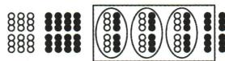
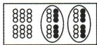

<!-- question-source:start -->
6 新考向传统文化 我国是最早认识负数的国家. 在古代数学名著《九章算术》里就记载了利用算筹实施“正负术”的方法, 图(1)表示的是计算 $3 + (-4)$ 的过程. 按照这种方法, 则图(2)的计算结果为 ( )

图(1) 图(2)
A.-7 B.-3 C.3 D.7
<!-- question-source:end -->

![[Q00096852A1]]
