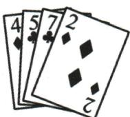
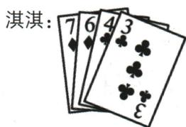

<!-- question-source:start -->
7[2025 河北石家庄调研, 中]嘉嘉和淇淇用扑克牌做数学游戏, 如图所示, 两人手中各有四张扑克牌, 并且都不知道对方手中的牌. 游戏规则是将方块“◆”记为正分, 如“◆2”记为+2分, 将梅花“♣”记为负分, 如“♣3”记为-3分. 两人各自同时从对方手中任意抽取一张牌, 与手中剩余的牌计算总分, 得分高的人获胜.

嘉嘉：

淇淇：

(1) 若嘉嘉从淇淇手中抽到“◆7”，同时淇淇从嘉嘉手中抽到“♣7”，分别计算此时嘉嘉和淇淇手中牌的总分，并判断谁获胜；

(2)在两人各自同时从对方手中任意抽取一张牌后,淇淇手中牌的总分最高可能是多少?

(3)在两人各自同时从对方手中任意抽取一张牌后,直接写出嘉嘉手中牌与淇淇手中牌的总分之和.
<!-- question-source:end -->

![[Q00098686A1]]
