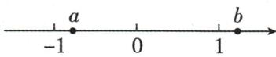

<!-- question-source:start -->
4[2024 河南信阳质检]有理数 a, b 在数轴上的对应位置如图, 则下列结论正确的是 ( )

A. $\frac{a}{b} > 0$ B. $\frac{a}{b} < 0$ C. $\frac{a}{b} = 0$ D. 无法确定
<!-- question-source:end -->

![[Q00095366A1]]
