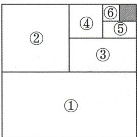

<!-- question-source:start -->
5[2025 安徽宣城期中, 中]如图, 将一张边长为 1 的正方形纸片分割成 7 个部分, 部分①面积是正方形纸片面积的一半, 部分②面积是部分①面积的一半, 部分③面积是部分②面积的一半, …, 依次类推, 请回答下列问题.

(1)阴影部分的面积是\_\_\_\_.

(2)以下是甲、乙两位同学求 $S=\frac{1}{2}+\frac{1}{2^{2}}+\frac{1}{2^{3}}+\frac{1}{2^{4}}+\frac{1}{2^{5}}+\frac{1}{2^{6}}$ 的方法:甲:利用已给正方形的面积和阴影部分的面积得 $S=1-S_{\text{阴影}}$ ;
乙： $S=\frac{1}{2}+\frac{1}{2^{2}}+\frac{1}{2^{3}}+\frac{1}{2^{4}}+\frac{1}{2^{5}}+\frac{1}{2^{6}}$ ，① $2S=1+\frac{1}{2}+\frac{1}{2^{2}}+\frac{1}{2^{3}}+\frac{1}{2^{4}}+\frac{1}{2^{5}}$ ，② ②-①，得 $S=1-\frac{1}{2^{6}}=\frac{63}{64}$ ，所以S的值为 $\frac{63}{64}$ 。请借助甲或乙同学的方法，求出 $2+2^{2}+2^{3}+2^{4}+\cdots+2^{99}$ 的值。
<!-- question-source:end -->

![[Q00100859A1]]
