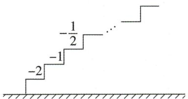

<!-- question-source:start -->
2[2025 浙江杭州期中, 中]如图, 阶梯图的每个台阶上都标着一个数, 从下到上的第1个至第3个台阶上依次标着-2, -1, - $\frac{1}{2}$ , 且任意相邻三个台阶上数的积都相等. 对下列结论判断正确的是 ( )
结论Ⅰ: 从下到上前2022个台阶上的数的积是-1;
结论Ⅱ: 数 $-\frac{1}{2}$ 所在的台阶数用正整数k表示为3k.

A. I对、Ⅱ错 B. I错、Ⅱ对 C. I和Ⅱ都对 D. I和Ⅱ都错
<!-- question-source:end -->

![[Q00096892A1]]
