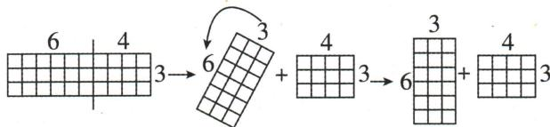

<!-- question-source:start -->
4 新考法[2025 河北保定期中]观察下图.

利用这种运算律可以得到 $(6+4)\times3=6\times3+4\times3=30.$

(1) 它的计算过程可以解释 \_\_\_\_ 这一运算律；

(2) 请你利用这种运算律计算: $118 \frac{4}{5} \times 999 + \left(-\frac{1}{5}\right) \times 999 - 18 \frac{3}{5} \times 999.$
<!-- question-source:end -->

![[Q00098736A1]]
