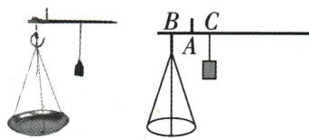

<!-- question-source:start -->
6[2023 宁夏中考]如图是某种杆秤. 在秤杆的点 A 处固定提纽, 点 B 处挂秤盘, 点 C 为 0 刻度点. 当秤盘不放物品时, 提起提纽, 秤砣所挂位置移动到点 C, 秤杆处于平衡. 秤盘放入 x 克物

建议用时-25分钟 答案-D28

品后移动秤砣, 当秤砣所挂位置与提纽的距离为 y 毫米时秤杆处于平衡. 测得 x 与 y 的几组对应数据如下表:

<table><tr><td>x/克</td><td>0</td><td>2</td><td>4</td><td>6</td><td>10</td></tr><tr><td>y/毫米</td><td>10</td><td>14</td><td>18</td><td>22</td><td>30</td></tr></table>

由表中数据的规律可知, 当 x = 20 克时, y = \_\_\_\_ 毫米.

<!-- question-source:end -->

![[Q00097033A1]]
