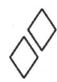
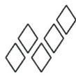
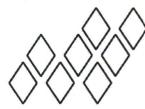
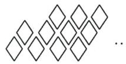

<!-- question-source:start -->
7[2024 重庆中考 B 卷]用菱形按如图所示的规律拼图案,其中第①个图案中有 2 个菱形,第②个图案中有 5 个菱形,第③个图案中有 8 个菱形,第④个图案中有 11 个菱形,…,按此规律,则第⑧个图案中,菱形的个数是 ( )

①

③

④

A. 20 B. 21 C. 23 D. 26
<!-- question-source:end -->

![[Q00097034A1]]
